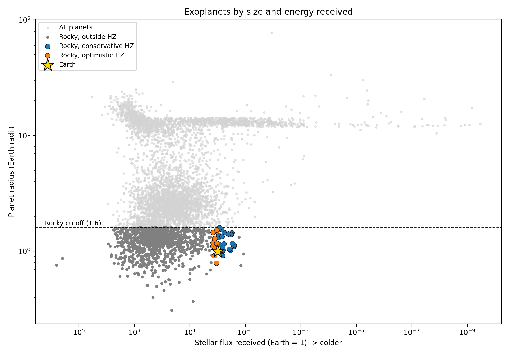
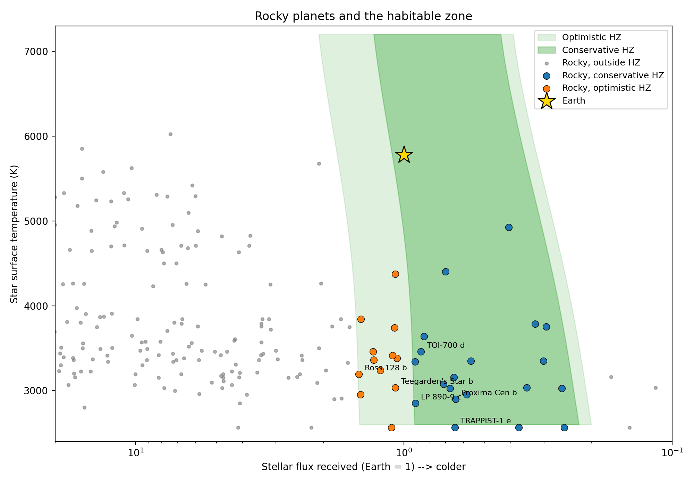
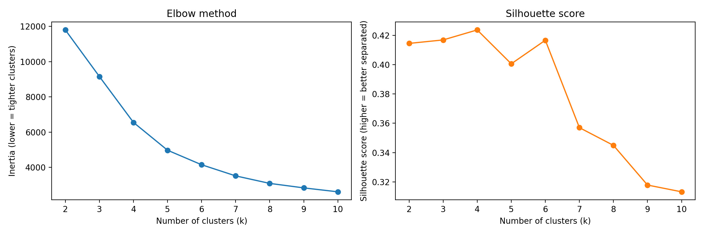
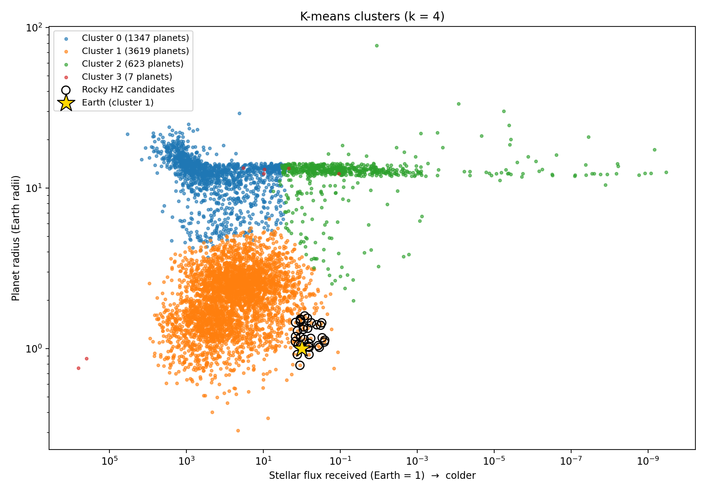

# Searching for Potentially Habitable Exoplanets with NASA Data

Out of thousands of planets discovered outside our solar system, which ones could support liquid water on their surface? This project uses real data from the [NASA Exoplanet Archive](https://exoplanetarchive.ipac.caltech.edu/) to find planets that are the right size to be rocky and receive the right amount of energy from their star for liquid water, then uses machine learning to see how they fit into the wider population of known planets.

Built in Google Colab with **pandas**, **NumPy**, **Matplotlib**, and **scikit-learn**.

---

## Key findings

- **32 potentially habitable planets** out of 6,451 known exoplanets are both small enough to be rocky (≤ 1.6 Earth radii) and inside their star's habitable zone: 20 in the conservative zone and 12 in the optimistic zone.
- The list independently recovers the planets astronomers consider top habitability candidates, including **Proxima Centauri b**, **TRAPPIST-1 e, f and g**, **Teegarden's Star b**, and **TOI-700 d**.
- **Nearly all candidates orbit red dwarfs**, stars much cooler and dimmer than the Sun. Their habitable zones are so close that planets there are easier to detect, but those planets may face strong stellar flares and are likely tidally locked.
- **Unsupervised clustering rediscovered the main planet types** (hot giants, small planets, cold giants, and an outlier group around extremely hot stars) using only three features and no labels. All 32 candidates and Earth fall in the "small planets" cluster.
- An Earth-similarity ranking surfaced **near misses** around Sun-like stars, such as **Kepler-452 b** and **Kepler-62 e**, which are in the habitable zone but missed the rocky-size cutoff by only a few hundredths of an Earth radius.

---

## Charts

### Planet size vs. energy received

Every confirmed planet, with the rocky habitable-zone candidates highlighted around Earth. Two known features of the exoplanet population are visible: the **radius valley** (a gap between rocky planets and mini-Neptunes near the 1.6 R⊕ cutoff) and the **hot Neptune desert** (few Neptune-sized planets at very high flux). The horizontal line of planets at about 13 R⊕ is a data artifact: giant planets whose radii were estimated from their masses rather than measured.

### The habitable zone

The conservative and optimistic habitable zones as a function of star temperature, with rocky planets plotted on top. The zone shifts to lower flux for cooler stars, because red starlight heats planets more efficiently.

### Choosing the number of clusters

The silhouette score peaks at k = 4 (0.424), which also sits at the elbow of the inertia curve.

### K-means clusters

All planets colored by cluster, with habitable-zone candidates outlined in black.

---

## Method

### 1. Data collection
Planet and star properties were downloaded directly into pandas from the NASA Exoplanet Archive's TAP service, using the **Planetary Systems Composite Parameters** (`pscomppars`) table, which has one row per confirmed planet. Fifteen columns were selected, covering planet size, mass and orbit, star temperature, radius, mass and luminosity, and distance from Earth.

### 2. Cleaning and filtering
- Removed planets missing any value needed for the analysis (radius, orbital distance, star luminosity, star temperature), plus impossible values and duplicates: **6,451 → 5,596 planets**.
- Flagged planets with radius **≤ 1.6 Earth radii** as potentially rocky. Above this size most planets have thick gas envelopes. This gave **1,098 rocky planets**, 94.3% of which were discovered by transit, meaning their radii are directly measured.

### 3. Stellar energy and the habitable zone
The energy each planet receives (insolation flux, in Earth units) was calculated with the inverse-square law:

$$S = \frac{L}{d^2}$$

where $L$ is the star's luminosity in solar units and $d$ is the orbital distance in AU. The result matched NASA's own values closely (median ratio 1.000, log-scale correlation 0.993).

Habitable zone boundaries were calculated for each star using the climate model of Kopparapu et al. (2014):

$$S_{\text{eff}} = S_{\text{eff},\odot} + a T_\star + b T_\star^2 + c T_\star^3 + d T_\star^4, \qquad T_\star = T_{\text{eff}} - 5780$$

- **Conservative zone:** between the *runaway greenhouse* (inner) and *maximum greenhouse* (outer) limits.
- **Optimistic zone:** between the *recent Venus* (inner) and *early Mars* (outer) limits.

The model is valid for stars between 2,600 K and 7,200 K. The 63 stars outside that range were flagged.

### 4. Visualization
Matplotlib scatter plots on log scales show planet size against energy received, and the habitable zone against star temperature.

### 5. Clustering
K-means clustering (scikit-learn) was run on three standardized features: log radius, log flux, and star temperature. The number of clusters was chosen using the elbow method and silhouette scores. Each planet's distance from Earth in the same scaled feature space was then used to rank planets by overall similarity to Earth.

---

## Results

### Rocky habitable-zone candidates (nearest first)

| Planet | Radius (R⊕) | Flux (Earth = 1) | Star temp (K) | Zone | Distance (pc) | Radius measured? |
|---|---|---|---|---|---|---|
| Proxima Cen b | 1.02 | 0.64 | 2900 | Conservative | 1.30 | No (estimated) |
| Ross 128 b | 1.11 | 1.47 | 3192 | Optimistic | 3.37 | No (estimated) |
| GJ 1061 d | 1.16 | 0.58 | 2953 | Conservative | 3.67 | No (estimated) |
| GJ 1061 c | 1.19 | 1.45 | 2953 | Optimistic | 3.67 | No (estimated) |
| Teegarden's Star c | 1.02 | 0.35 | 3034 | Conservative | 3.83 | No (estimated) |
| Teegarden's Star b | 1.05 | 1.08 | 3034 | Optimistic | 3.83 | No (estimated) |
| GJ 1002 c | 1.10 | 0.26 | 3024 | Conservative | 4.85 | No (estimated) |
| GJ 1002 b | 1.03 | 0.67 | 3024 | Conservative | 4.85 | No (estimated) |
| GJ 273 b | 1.51 | 1.06 | 3382 | Optimistic | 5.92 | No (estimated) |
| GJ 667 C e | 1.45 | 0.30 | 3350 | Conservative | 7.24 | No (estimated) |
| GJ 667 C f | 1.45 | 0.56 | 3350 | Conservative | 7.24 | No (estimated) |
| GJ 3378 b | 1.32 | 0.91 | 3340 | Conservative | 7.72 | No (estimated) |
| Wolf 1069 b | 1.08 | 0.65 | 3158 | Conservative | 9.58 | No (estimated) |
| L 98-59 f | 1.48 | 1.10 | 3415 | Optimistic | 10.62 | No (estimated) |
| TRAPPIST-1 f* | 1.04 | 0.37 | 2566 | Conservative | 12.43 | Yes |
| TRAPPIST-1 d* | 0.79 | 1.12 | 2566 | Optimistic | 12.43 | Yes |
| TRAPPIST-1 e* | 0.92 | 0.65 | 2566 | Conservative | 12.43 | Yes |
| TRAPPIST-1 g* | 1.13 | 0.25 | 2566 | Conservative | 12.43 | Yes |
| TOI-700 d | 1.14 | 0.86 | 3459 | Conservative | 31.13 | Yes |
| TOI-700 e | 0.92 | 1.31 | 3459 | Optimistic | 31.13 | Yes |
| LP 890-9 c | 1.37 | 0.91 | 2850 | Conservative | 32.43 | Yes |
| TOI-715 b | 1.55 | 0.71 | 3075 | Conservative | 42.40 | Yes |
| K2-3 d | 1.46 | 1.45 | 3844 | Optimistic | 44.07 | Yes |
| K2-72 e | 1.29 | 1.30 | 3360 | Optimistic | 66.43 | Yes |
| Kepler-1649 c | 1.06 | 1.23 | 3240 | Optimistic | 92.19 | Yes |
| Kepler-62 f | 1.41 | 0.41 | 4925 | Conservative | 300.87 | Yes |

\* TRAPPIST-1 (2,566 K) is slightly below the habitable-zone model's 2,600 K limit, so its boundaries are a small extrapolation.

The full list of 32 candidates is in the notebook. Note the pattern in the last column: every candidate within about 11 parsecs was found by radial velocity, so its radius is estimated from its mass, while the candidates with directly measured radii are farther away.

### Near misses worth investigating

| Planet | Radius (R⊕) | Flux | Star temp (K) | Why it missed |
|---|---|---|---|---|
| Kepler-452 b | 1.63 | 1.11 | 5757 | 0.03 R⊕ over the rocky cutoff; orbits a near-twin of the Sun |
| Kepler-62 e | 1.61 | 1.15 | 4925 | 0.01 R⊕ over the rocky cutoff |
| Kepler-22 b | 2.10 | 0.98 | 5596 | In the conservative zone, but likely a mini-Neptune |
| tau Ceti f | 1.81 | 0.28 | 5310 | Just past the cold edge of the zone; one of the nearest Sun-like stars (3.6 pc) |

### Clusters (k = 4)

| Cluster | Planets | Median radius (R⊕) | Median flux | Median star temp (K) | Interpretation |
|---|---|---|---|---|---|
| 0 | 1,347 | 12.7 | 264 | 5,710 | Hot giants |
| 1 | 3,619 | 2.12 | 68.5 | 5,494 | Small planets (includes Earth and all 32 candidates) |
| 2 | 623 | 12.8 | 0.16 | 5,508 | Cold giants |
| 3 | 7 | 12.3 | 9.67 | 29,300 | Outliers around extremely hot stars |

---

## Limitations

- **Habitable zone ≠ habitable.** Size and energy are necessary conditions, not proof. Atmosphere, magnetic field, stellar activity, and tidal locking all matter and aren't in this dataset.
- **Estimated radii.** Planets found by radial velocity don't have measured sizes. Their radii are estimated from mass, and radial velocity only gives a minimum mass, so some may be larger than listed.
- **Hard cutoffs.** The 1.6 R⊕ rocky limit is an approximation of a gradual transition. Planets just above it (like Kepler-452 b) may still be rocky.
- **Detection bias.** Planets close to their stars and around small stars are easier to find, so the sample over-represents hot planets and red-dwarf systems.
- **Clustering.** A silhouette score of about 0.42 means the clusters are real but overlapping, since planet types blend into each other. The Earth-similarity ranking weights all features equally, so a planet can rank as "Earth-like" while being far too hot for liquid water.
- **Data changes.** The archive is updated regularly. This analysis used data downloaded in October 2026, and rerunning the notebook will give slightly different counts.

---

## How to run

1. Click the **Open in Colab** badge at the top of this page.
2. Run all cells (Runtime --> Run all). The data downloads automatically from the NASA Exoplanet Archive; no API key or account is needed.
3. To experiment, change `ROCKY_MAX_RADIUS` (#5) or `K` (Cell #14) and rerun.

Requirements are all preinstalled in Colab: `pandas`, `numpy`, `matplotlib`, `scikit-learn`.

---

## Data source and acknowledgment

This research has made use of the NASA Exoplanet Archive, which is operated by the California Institute of Technology, under contract with the National Aeronautics and Space Administration under the Exoplanet Exploration Program.

## References

- Kopparapu, R. K., et al. (2014). Habitable Zones around Main-sequence Stars: Dependence on Planetary Mass. *The Astrophysical Journal Letters*, 787, L29.
- Rogers, L. A. (2015). Most 1.6 Earth-radius Planets Are Not Rocky. *The Astrophysical Journal*, 801, 41.
